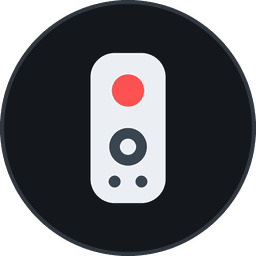

  

<h1 align="center">CEC Remote Remap</h1>

<b>CEC Remote Remap</b> gives the buttons on your <b>TV remote</b> new jobs on <b>NVIDIA Shield</b> and other <b>Android TV</b> devices. No root, no ADB and no extra remote needed.

&nbsp;

# **Overview**

📺 **Your TV Remote, Your Rules** When your Shield is controlled with the TV's own remote over HDMI-CEC, the colored buttons and other extras usually do nothing. CEC Remote Remap gives them a job and lets you decide what they do.

👆 **Press, Double Press & Hold** Every button can have up to three different actions. Press the red button to go Home, double press it for Recent apps, hold it to start the screensaver.

🔒 **Navigation Stays Safe** Arrow keys can't be remapped, and **OK** and **Back** always keep their normal press, so you can never lock yourself out. You can still give them a Double press or Hold, like holding Back to go Home.

⌨️ **Keeps Your Keyboard** Typing and your on-screen keyboard work exactly like before.

⏱️ **Your Own Timing** Adjust the hold time and double press speed to match how fast you press.

&nbsp;

# **Instructions**

1. **Setup:** Open the app and follow the two quick setup steps. The app takes you straight to the right place in Settings each time.
2. **Add a button:** Choose **Add a button** and press the button on your TV remote you want to change.
3. **Pick actions:** Choose what **Press**, **Double press** and **Hold** should do for that button.
4. **Adjust:** Not fast enough or too fast? Change **Hold time** and **Double-press speed** in Options with ◀ ▶.

&nbsp;

> [!TIP]
> **Hold Back for Home:** Add the Back button and set its **Hold** to **Home**. A short press still goes back like always, holding it takes you straight to the home screen from any app!

> [!NOTE]
> Most TVs keep some buttons for themselves (Home, Settings, Source, Volume) and never send them to the Shield, so those can't be remapped. If nothing happens when you press a button in **Add a button**, that's the reason.

&nbsp;

# **Download**

Coming soon on Google Play.

&nbsp;

# **Free & Pro**

* **Free** – One remote button with a Press action, so you can try it on your own TV first.
* **Pro** – A one-time in-app purchase on Google Play that unlocks unlimited buttons, Double press, Hold and the timing options. No subscription.

&nbsp;

# **Features**

* **Any Remote Button** – Colored buttons, number keys, media keys and more. Press it once in the app and it's added.
* **Three Actions Per Button** – Separate Press, Double press and Hold actions for every button.
* **Home, Back & Recent Apps** – System navigation from any button, in any app.
* **Open Apps** – Launch any installed app with one press.
* **Open App Screens** – Jump straight to a specific screen inside an app, like a Settings page.
* **Shortcuts & Links** – Open app shortcuts or any link (YouTube channels, websites and more).
* **Media Controls** – Play/Pause, Next, Previous and Stop.
* **Sleep, Screensaver & Screenshot** – Put the Shield to sleep, start the screensaver or take a screenshot.
* **Move & Swap** – Move a button's settings to another button, or swap two buttons.
* **Adjustable Timing** – Hold time from 0.00 to 1.50 s and double press speed from 0.00 to 0.80 s.
* **Reset Everything** – Back to a fresh install with one button.
* **Lightweight & Private** – Under 1 MB, no ads, no tracking, and nothing you see or type ever leaves your device. The only internet use is Google Play's purchase system for the Pro unlock.

&nbsp;

# **Legal**

📜 [Privacy Policy](./privacy_policy.md)

NVIDIA and SHIELD are trademarks of NVIDIA Corporation. Android, Android TV and Google Play are trademarks of Google LLC. HDMI is a trademark of HDMI Licensing Administrator, Inc. CEC Remote Remap is not affiliated with or endorsed by them.

&nbsp;

# **Support**

**CEC Remote Remap** has no ads and no subscription. If it made your TV remote more useful, you can also support the project here:

Found a bug or have an idea? Open an [issue](https://github.com/Desiwah/cec-remote-remap/issues) and let me know.

Thank you! ❤️
